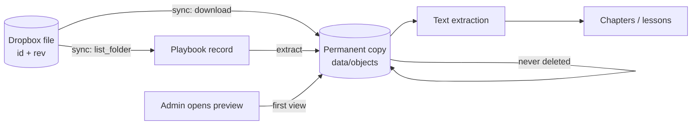
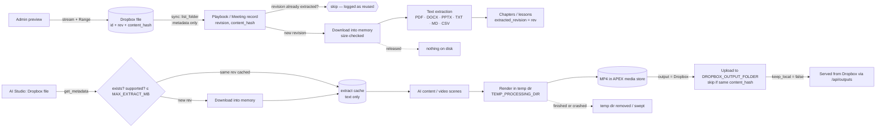

# Dropbox file lifecycle

How a document in Dropbox becomes chapters, lessons, a meeting summary or a video in APEX — and
what is (and is no longer) stored on the APEX server along the way.

## Before

Every revision of every file that was synced, extracted or previewed stayed on disk, including files
whose playbook was later deleted.

## After

## Stage by stage

| Stage | Reads from Dropbox | Writes on APEX | Kept for |
|---|---|---|---|
| Sync | Metadata (`list_folder`) | Database rows only | Record lifetime |
| Extraction (playbook) | File bytes, into memory | Chapters in the database | Record lifetime |
| Extraction, same revision again | Nothing | Nothing (generation log row `reused`) | — |
| Meeting transcript | File bytes, into memory | Meeting fields in the database | Record lifetime |
| Preview / download | Streamed, Range passed through | Nothing | — |
| AI Studio from a Dropbox file | Metadata, then bytes into memory on a new revision | Extracted text (`extract-cache`) | `EXTRACT_CACHE_RETENTION_DAYS` (90) |
| Video render | — | Scene frames + audio in a temp dir, then MP4 / subtitles / thumbnail in the media store | Temp: until the job ends. Media: while a record uses it |
| Video output to Dropbox | Upload (single ≤150 MB, else 64 MB chunks) | Dropbox id/rev on the record; local MP4 removed if `keep_local=false` | Dropbox's own retention |

## When a file changes, moves or is deleted in Dropbox

- **Changed** — a new `rev` / `content_hash` on the next sync; the record shows a pending revision;
  extraction runs on the new revision only (automatically if `AUTO_EXTRACT_ON_SYNC=true`).
- **Moved / renamed** — same file id, so the record is kept; its path is refreshed. No re-processing.
- **Deleted** — the record is archived on the next sync (generated lessons stay). Any old copy on APEX
  becomes `dropbox-orphan` and is removed by clean-up.
- **Deleted before an AI Studio job** — `get_metadata` returns not-found and the request fails with
  404 "That Dropbox file no longer exists (deleted or moved)".

Originals are never written to, renamed or deleted in Dropbox. The only write APEX makes is the optional
video upload into its own output folder.
