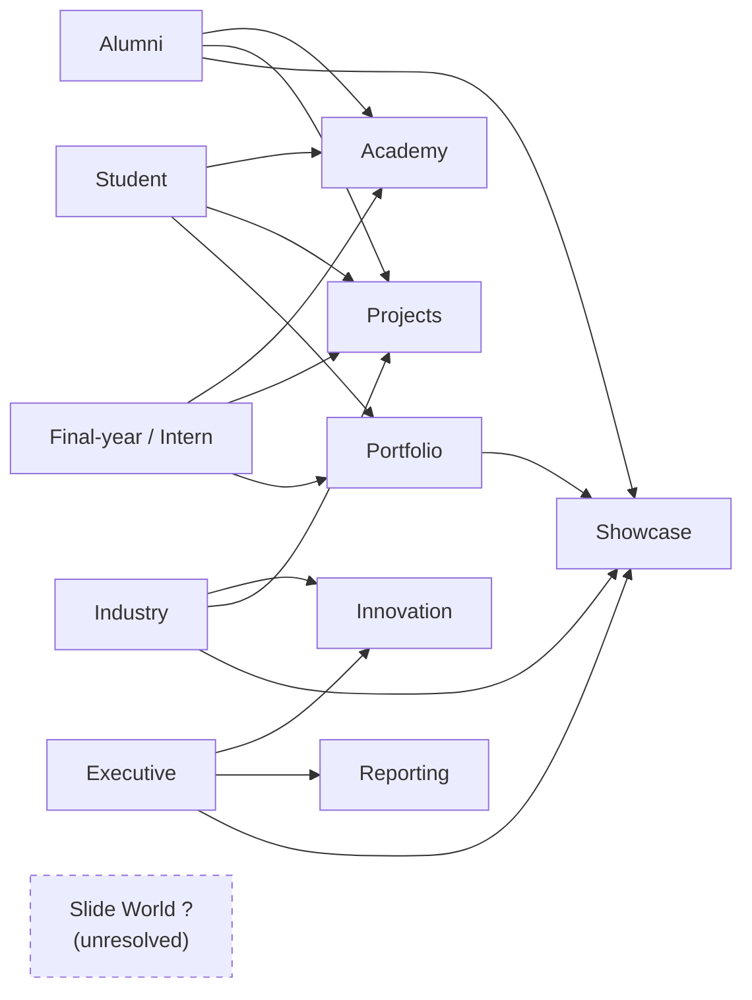
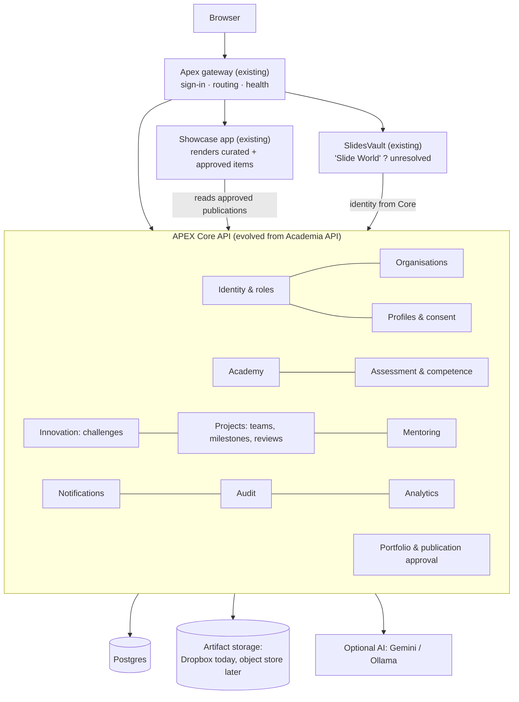
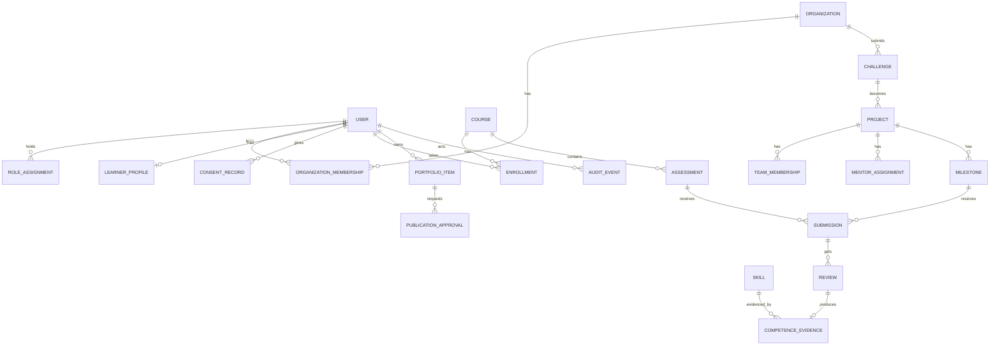
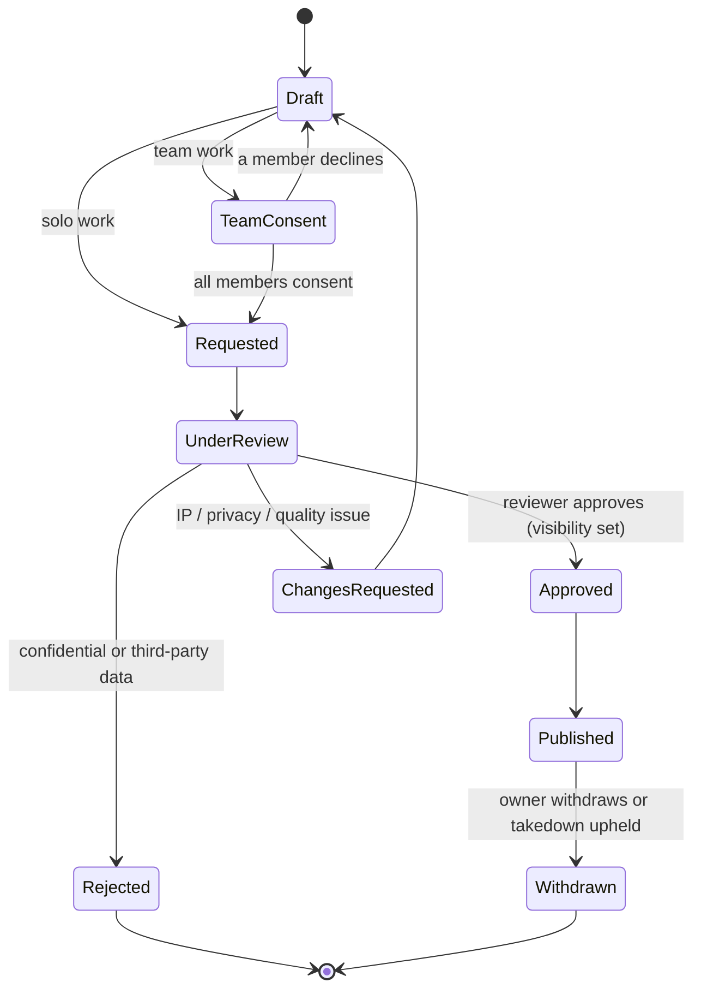

# APEX — Persona and Platform Master Plan

Prepared 14 November 2026 from the Apex repository, branch `Feature-base-removal`. The last commit is `403c989`; uncommitted remediation work (84 files) is also included.
Author role: Product Architect, Platform Architect and Engineering Planning Lead.

**How to read this document**
- **[V] Verified.** Seen in the repository; a file path is given.
- **[A] Assumption.** Reasoned but not confirmed.
- **[P] Proposed.** A recommendation; nothing of it exists yet.
- **[?] Open question.** Needs founder input.

No screenshots, live database, production deployment or usage analytics were supplied. Database findings come from schema and migration code and from the read-only audit of the local Academia database (`docs/architecture/APEX_FULL_AUDIT_REPORT.md`, section F). No code was changed for this analysis.

---

## 0. Findings and recommendations (read this first)

### Findings

1. **[V] APEX today is a gateway in front of three separate applications, not one platform.**
   - The applications are the Innovation Showcase, SlidesVault and Inspironics Academia (`apex/projects.mjs`, `PROJECTS`).
   - Each has its own database, user table, roles and sessions.
   - The gateway's "one sign-in" posts the same email and password to each app's own login (`apex/auth.mjs`, `signIn`). **Identity is therefore duplicated three times.**
2. **[V] Existing roles cannot express the five personas.**
   - Each app has one `role` column:
     - Academia: `admin` / `user` (`Inspironics Academia/packages/shared/src/constants.js`).
     - Showcase: `admin` / `viewer` / `guest` (`inspironics-innovation-showcase/packages/shared/src/roles.js`).
     - SlidesVault: `admin` / `user` (`slide vault/packages/shared/src/roles.js`).
   - Academia adds one **audience** per user: `intern` / `employee` / `leadership` (`Inspironics Academia/packages/shared/src/audience.js`; column added by migration `005_user_audience`). This is the closest existing analogue to personas, but it only filters content visibility.
3. **[V] Academia is the most complete foundation.**
   - It has 25 declarative entities with row-level access rules (`packages/shared/src/entities.js`).
   - It covers courses, modules, lessons, quizzes, assessments, completion certificates with public verification, spaced repetition, recertification, meetings, action items, notifications and a job queue.
   - It is designed for **internal staff learning from Inspironics engineering playbooks**, not for external students. Its default categories are "Learning & Development", "Corporate Knowledge Base" and so on (`audience.js`, `DEFAULT_CATEGORIES`).
4. **[V] The Showcase is a curated corporate catalogue, not a user portfolio.**
   - Plates are synced from an Inspironics Dropbox folder, and only admins edit them (`PATCH /api/entities/plates/:id`).
   - There is no submission, review or publication workflow for user work.
5. **[V] Nothing exists for:**
   - organisations or organisation membership
   - multiple roles per person
   - learner or professional profiles beyond name, avatar and audience
   - skills or competence evidence
   - projects, challenges, milestones, submissions, project reviews or mentor assignments
   - portfolios or governed publication
6. **[V] Course completion and formal certification are already partly separated, but competence is not modelled.**
   - Academia issues a completion certificate after a passed final test (`submitFinalTest.js`). Certificates carry valid / recert_required / expired / superseded states (`verifyCertificate.js`).
   - An assessment type is literally named `certification` (`entities.js`, Assessment type enum). This risks implying an accredited certification that does not exist.
7. **[?] The named area "Slide World" cannot be confirmed.**
   - The closest implemented area is **SlidesVault**, a presentation library (`slide vault/`). The name is phonetically close, but nothing in the repository says "Slide World", and its intended purpose for the personas is unknown. **This plan keeps it unresolved.**
8. **[?] "Innovations" and "Showcase" are one application today.**
   - It is the Innovation Showcase; its hero labels the plate count "Innovations".
   - No separate "Innovations" module (ideas or challenges) exists.
9. **[V] Operational maturity is early.**
   - It runs on one Windows machine (`start.bat`), on SQLite, with no production deployment.
   - Dropbox, email and Google sign-in have been tested only against mocks (audit, section G).
   - A remediation pass is uncommitted: it adds root CI, security defaults and 621 passing tests (`docs/APEX_BROCHURE_INPUT_PACK.md`, section 13 update).

### Recommendations

1. **[P] Build one platform core, not five apps and not microservices.**
   - Promote Academia's API into the APEX Core. It already has the generic entity layer, row rules, jobs, notifications and the richest domain.
   - Add identity, roles, organisations, profiles, projects, challenges, portfolio and publication there as logical modules.
   - Keep the Showcase and the "Slide World"/SlidesVault area as separate content apps behind the existing gateway. Move their sign-in onto Core identity.
2. **[P] Model personas as role assignments on one user, with history.**
   - Example: a student becomes an intern, then alumni. Each transition closes one assignment and opens the next, and no identity is duplicated.
3. **[P] Put project execution in a new Projects module inside Core**, not in Academy and not in Showcase.
   - Academy teaches and assesses.
   - Innovation captures ideas and industry challenges.
   - Projects executes and evaluates.
   - Showcase publishes approved outcomes.
4. **[P] Keep three evidence levels distinct throughout:**
   - **Completion:** a course was finished.
   - **Demonstrated competence:** a reviewed submission is mapped to a skill.
   - **Formal certification:** issued by an external body. APEX holds none today.
5. **[P] Sequence:**
   1. Discovery
   2. Identity and roles
   3. Student Academy journey
   4. Projects, mentoring and *private* portfolio, with the governed publication workflow
   5. Alumni and industry
   6. Executive reporting and the public Showcase
   7. Hardening

   This changes one thing in the suggested order. The publication workflow moves into phase 4 because the student and intern journeys end in portfolio evidence; it should not wait for phase 6.

---

## 1. Executive product definition

**Purpose [P].** APEX is Inspironics's single place where people learn engineering practice, apply it on real projects and industry challenges, and show verified evidence of what they did. Leaders sponsor that work and see its outcomes.

| Persona | Value APEX offers [P] |
|---|---|
| Students (not final year) | Structured learning from Inspironics practice, assessed progress, guided mini-projects, a private portfolio they control |
| Final-year students and internship candidates | A transparent internship path: apply → eligibility → assigned project → mentoring → evaluated milestones → completion evidence |
| Alumni | Continued learning; a route back as mentors or contributors; a verified professional showcase |
| Industry professionals and partners | A governed way to bring challenges, collaborate with vetted teams, and validate outcomes, with protected IP and data |
| CEOs, VPs, Directors | Sponsor initiatives against strategic objectives; see evidence-based progress and outcomes, not activity counts |

**How the areas form one platform [P]:**

| Layer | What it holds |
|---|---|
| Shared core | One identity, roles, organisations, skills, projects, notifications, audit |
| **Academy** | Learning, assessment and competence evidence |
| **Innovation** | Ideas and challenges; the demand side |
| **Projects** | Execution and evaluation; the delivery side |
| **Showcase** | Governed publication of outcomes and portfolios |
| **"Slide World" (unconfirmed)** | Placement deferred until its purpose is confirmed (§13) |

---

## 2. Current-state assessment

| Area | Evidence | Current capability | Gap | Impact | Recommended action | Confidence |
|---|---|---|---|---|---|---|
| Single sign-in | `apex/auth.mjs`, `apex/server.mjs` | [V] One form signs into all apps. Session revoked at sign-out; Secure cookie behind HTTPS (uncommitted) | Identity copied per app; the same email must exist in each DB; no shared profile | Personas and role history impossible across apps | Core identity as source of truth; gateway asserts identity to apps (R1) | High |
| Roles | `constants.js`, `roles.js` (Showcase, SlidesVault) | [V] One role per user per app | No multiple roles, no history, no scoping to an organisation or project | Cannot model student → intern → alumni, mentors or org admins | `RoleAssignment` with scope and validity dates (R1) | High |
| Audience segmentation | `Inspironics Academia/packages/shared/src/audience.js` | [V] intern / employee / leadership drive content visibility | Single value; not persona-aligned; employee-centric | Useful seed for persona-based visibility | Map to persona-driven visibility rules (R1–R2) | High |
| Organisations | Audit section B: "none of the apps is multi-tenant" | [V] None | No orgs, memberships or org admins | Industry persona and executive sponsorship impossible | `Organization` + `OrganizationMembership` (R1 schema, R4 UX) | High |
| Learner profile | `users` table, `migrations.js` (001, 004 avatar, 005 audience) | [V] Name, email, avatar, audience | No institution, year of study, graduation, consent, skills | Eligibility review and alumni verification impossible | `LearnerProfile` / `ProfessionalProfile` (R1–R2) | High |
| Courses and lessons | `entities.js` (Course, Module, Lesson, Chapter); `pipeline/*` | [V] AI-drafted, human-approved courses from playbooks; drag-and-drop editor | Content is internal-playbook oriented; no public catalogue; no enrolment approval | Students can consume only what admins expose by audience | Reuse as-is; add enrolment and persona catalogue (R2) | High |
| Assessment | `submitQuiz.js`, `submitFinalTest.js`, `shared/finalTest.js` | [V] Server-graded quizzes, chapter and final tests; answers never sent to learners | No rubric-based or human-reviewed assessment; no skill mapping | Competence cannot be evidenced | Add `Submission` + `Review` with rubric and skill mapping (R2–R3) | High |
| Certificates | `verifyCertificate.js`, `components/certificates/*` | [V] Completion certificate with public verification and recert states | Assessment type named `certification`; wording can imply accreditation | Reputational and legal risk | Rename to "completion record"; reserve "certification" for external bodies (R2) | High |
| Recertification | `shared/recert.js`, `AdminCompliance.jsx` | [V] Re-cert when the source playbook changes or expires | Employee-compliance framing | Valuable for alumni and professionals | Keep; persona-scoped (R4) | High |
| Projects, challenges, mentoring | No entities in any app | [V] Absent. `VideoProject` is a media render job; `ActionItem` belongs to meetings | Whole domain missing | Internship and industry journeys impossible | New Projects and Innovation modules in Core (R3–R4) | High |
| Teams | `entities.js`, `Team` (line ~2068) | [V] Roster of names in JSON for meeting attribution | Not linked to user accounts | Cannot reuse for project teams | New `TeamMembership` keyed by user ID; keep `Team` for meetings (R3) | High |
| Showcase content | `inspironics-innovation-showcase/apps/api/src/routes/entities.js`; `sync/*` | [V] Curated Dropbox-synced plates; admin-only edits; analytics; PDF report; 3D explorer | No user submissions, visibility levels or review workflow | Cannot host student or alumni work safely | `PortfolioItem` + `PublicationApproval` in Core; Showcase renders approved items (R3, R5) | High |
| "Slide World" | `slide vault/` (SlidesVault, presentation library) | [V] SlidesVault: deck library, viewer, offline, audit log | [?] Unknown whether this is "Slide World" or what it should do for personas | Planning blocked for this area | Founder to confirm name and purpose (R0) | Low |
| Innovation (ideas) | Showcase only | [V] No ideas or challenge capture | Missing | Industry and executive journeys lack an intake | New Innovation module (R4) | Medium |
| Notifications | `Inspironics Academia/apps/api/src/notify/*` | [V] 13 in-app kinds; email outbox with providers (real delivery unverified) | Learning-specific; no project or approval events | Approvals will stall without notifications | Generalise to Core events (R1–R3) | High |
| Audit | SlidesVault `AuditService.js`; Academia `login_history`, `generation_log` | [V] Partial and per app | No platform-wide audit trail | Approvals and publication need traceability | Core `AuditEvent` (R1) | High |
| Search | Gateway palette (`apex/public/index.html`); per-app search | [V] Client-side, per app | No cross-domain search over people, projects, challenges | Discovery limited | Defer; Core search endpoint later (R5) | Medium |
| Analytics | Showcase `GET /api/entities/analytics`; SlidesVault analytics; Academia admin dashboard | [V] Usage analytics per app | No outcome metrics, persona funnels or exec views | Executives cannot assess outcomes | Metrics model §12 (R5) | High |
| Privacy and consent | No consent or export code found; `docs/APEX_BROCHURE_INPUT_PACK.md` §11 | [V] None (no export or erasure, no consent capture) | Required for students (possibly minors [?]) and public portfolios | Legal exposure | Consent records, export/erasure, visibility controls (R1–R3) | High |
| Deployment | `start.bat`; `slide vault/apps/api/Dockerfile`; `.github/workflows/ci.yml` (uncommitted) | [V] Single Windows host, SQLite; Postgres untested | No hosted environment, backups or HA | Pilot cannot run for external users | Containerise and host Core with Postgres (R1, R6) | High |
| Testing | 621 tests (gateway 13, Academia 246, Showcase 150, SlidesVault 212) | [V] Strong API tests | No web tests in Academia or SlidesVault; no browser end-to-end tests in CI | Persona UX regressions undetected | Add end-to-end persona journeys to CI (R2 onward) | High |

---

## 3. Persona and experience matrix

**Account types [P]**
- **Individual user.** Every person, whichever persona.
- **Organisation account.** A university, industry partner, or Inspironics itself. It is not a login.
- **Organisation administrator.** An individual with an `org_admin` role scoped to one organisation.

Operational roles, independent of persona: **Mentor**, **Assessor/Reviewer**, **Content editor**, **Publication reviewer**, **Platform administrator**.

| | 1. Student (not final year) | 2. Final-year / internship candidate | 3. Alumni | 4. Industry professional / partner | 5. CEO, VP, Director |
|---|---|---|---|---|---|
| **Primary goals** | Learn fundamentals, practise, build early evidence | Win and complete an internship with evaluated evidence | Keep learning, give back, show professional record | Bring challenges, collaborate, access talent, validate outcomes | Align initiatives to strategy; see outcomes |
| **Entry conditions** | Invitation or self-registration with an institution email [?]; consent accepted | Student role + final-year or graduation date within window, or external candidate application | Prior student/intern record at Inspironics, or verified graduation [?] | Member of a verified organisation, or invited individual | Inspironics leader or partner executive; invited by platform admin |
| **Onboarding fields** | Name, institution, programme, year of study, expected graduation, interests, consent (data, publication) | + CV/portfolio links, availability window, preferred domains, eligibility declarations | Graduation year, current employer/role (optional), mentoring availability, visibility preferences | Organisation, title, domain expertise, NDA/IP terms acceptance | Organisation, portfolio of objectives, reporting preferences |
| **Landing dashboard** | My learning, next lesson, review due, mini-projects, portfolio drafts | Application status, assigned project, milestones due, mentor messages | Learning, mentoring requests, contributions, profile completeness | Org challenges and status, collaborating teams, outcome reviews | Objectives → initiatives → progress and outcome evidence |
| **Modules** | Academy, Projects (mini), Portfolio | Academy, Projects, Mentoring, Portfolio | Academy, Mentoring, Projects (contribution), Showcase | Innovation (challenges), Projects, Showcase | Innovation (sponsorship), Projects (read), Reporting, Showcase |
| **Key workflows** | Enrol, learn, test, submit mini-project, request publication | Apply, eligibility review, accept project, milestone submissions, evaluation | Verify alumni status, mentor assignment, contribute, publish profile | Org onboarding, submit challenge, review proposals, collaborate, validate outcome | Define objective, sponsor initiative, review progress, assess outcome |
| **Permissions (summary)** | Own records; team records; public content | + own application; assigned project space | Own; mentees' shared work (if mentor) | Own org's challenges and their projects; never other orgs' data | Read sponsored initiatives and aggregated outcomes; no individual private evaluations unless granted |
| **Visibility default** | Private; portfolio items private until approved | Private; evaluations visible to intern, mentor, assessors | Profile opt-in public | Org-confidential by default | Internal |
| **Outputs and evidence** | Completion records, competence evidence, mini-project submissions | Milestone evaluations, completion evidence, mentor endorsement | Mentoring record, contributions, published profile | Challenge outcomes, validated results | Outcome assessments per objective |
| **Transitions and overlaps** | → Final-year (year/graduation date) | → Intern (accepted) → Alumni (programme end) | Can also be Mentor, Industry professional | Can also be Mentor, Alumni | Can also be Sponsor of several orgs' initiatives |

**Transitions [P].** A transition never creates a new user.
- It closes the old `RoleAssignment` (`valid_to`) and opens the new one. Both remain in history.
- Records keep their original context. An intern's evaluations stay attached to the internship assignment.

---

## 4. Information architecture [P]

**Public, signed out**
- Home
- Programmes (Academy overview)
- Showcase (public, approved items only)
- Challenges (only those a partner marks public)
- Certificate / completion verification. [V] This page exists today: `apex/public/verify.html`.
- Sign in / Apply

**Signed-in navigation by persona**

| Persona | Primary navigation |
|---|---|
| Student | Home · Learn · Practice (mini-projects) · Portfolio · Profile |
| Final-year / intern | Home · Learn · Internship (application, project, milestones) · Mentor · Portfolio |
| Alumni | Home · Learn · Mentoring · Contributions · Professional profile |
| Industry | Home · Challenges · Collaborations · Outcomes · Organisation (if org admin) |
| Executive | Home · Objectives · Initiatives · Outcomes · Reports |

- **Shared workspace** (any project member): Project overview · Milestones · Submissions · Discussion · Files · Team.
- **Mentor:** Mentees · Reviews due · Office hours/requests.
- **Assessor/reviewer:** Review queue · Rubrics · Calibration.
- **Publication reviewer:** Publication queue · Visibility · Takedown requests.
- **Administrator:** People and roles · Organisations · Programmes and cohorts · Content (Academy authoring, existing) · Integrations · Audit · Settings.
- **Leadership:** Objectives · Portfolio of initiatives · Outcome reviews · Metrics.
- **"Slide World" (unresolved):** no navigation is proposed until its purpose is confirmed. If it is SlidesVault, it would sit under a shared "Library" entry for staff and mentors [A].

**Screen inventory and reuse**

| Screen | Exists? | Personas reusing it |
|---|---|---|
| Sign-in / gateway dashboard | [V] `apex/public/login.html`, `index.html` | All |
| Course catalogue, lesson, quiz, final test | [V] Academia pages (`CourseCatalog.jsx`, `LessonPlayer.jsx`, `ChapterTest.jsx`, `FinalTest.jsx`) | 1, 2, 3, 4 |
| Daily review (spaced repetition) | [V] `DailyReview.jsx` | 1, 2, 3 |
| Completion record + verify | [V] `CertificateView.jsx`, `CertificateVerify.jsx` | 1, 2, 3, public |
| Admin learners / courses / compliance | [V] `AdminLearners`, `AdminCourseEditor`, `AdminCompliance` | Admin, content editor |
| Meetings and action items | [V] `Meetings.jsx`, `MyActionItems.jsx` | Interns, mentors, staff (reuse inside projects [P]) |
| Profile and onboarding (persona-aware) | [P] | All |
| Role and organisation admin | [P] | Platform admin, org admin |
| Application and eligibility review | [P] | 2, admin |
| Project workspace (milestones, submissions, reviews) | [P] | 1 (mini), 2, 3, 4, 5 (read) |
| Mentor console | [P] | Mentors (3, 4, staff) |
| Challenge intake and review | [P] | 4, 5, admin |
| Portfolio editor + publication request | [P] | 1, 2, 3 |
| Publication review queue | [P] | Publication reviewer |
| Objectives and initiative dashboard | [P] | 5 |
| Showcase gallery, 3D explorer, report | [V] Showcase | Public (approved), all signed-in |

---

## 5. Module responsibility map

| Module | Purpose | Users | Features | Inputs | Outputs | Dependencies | Owner role |
|---|---|---|---|---|---|---|---|
| **Core platform** [P] (from Academia API [V]) | Identity, roles, orgs, profiles, consent, notifications, audit | All | Accounts, role assignments, orgs, profiles, consent, notifications, audit, search (later) | Registrations, invitations, admin actions | Authorised identity for every module | Postgres, email | Platform architect |
| **Academy** [V] + [P] | Learning and assessment | 1–4, editors, assessors | [V] Courses, lessons, quizzes, tests, completion records, review, recert. [P] Enrolment, persona catalogue, rubric assessments, skill mapping | Playbooks, curricula, learner activity | Completion records, competence evidence | Core | Academy & assessment lead |
| **Innovation** [P] | Ideas and industry challenges | 4, 5, staff, admin | Challenge intake, triage, IP/NDA terms, visibility, idea backlog, sponsorship | Org challenges, internal ideas, objectives | Approved challenges → projects | Core, Projects | Product lead |
| **Projects** [P] | Execution and evaluation | 1–5, mentors, assessors | Projects, teams, milestones, submissions, reviews, mentor assignments, completion evidence | Approved challenges, internship slots, mini-project briefs | Evaluations, completion evidence, outcome validation | Core, Academy (skills), Innovation | Backend/data lead |
| **Showcase** [V] + [P] | Publication of curated and approved work | Public, all | [V] Curated plates, gallery, 3D explorer, analytics, report. [P] Render approved `PortfolioItem`s with visibility levels | Approved publications, curated catalogue | Public/internal galleries | Core publication workflow | Product lead + publication reviewer |
| **"Slide World"** [?] | **Unresolved** | Unknown | Unknown. SlidesVault [V] provides a deck library | — | — | — | To be assigned after confirmation |

**Boundaries [P]**
- **Academy** ends at evidence of learning: completion records and competence evidence from assessed work. It does not run projects.
- **Innovation** ends when a challenge or idea is approved and converted into one or more projects.
- **Projects** owns everything from team formation to the final evaluation and outcome validation. *Validation result:* no project execution exists in any app today. Academia's meetings and action items are the nearest reusable parts (attach them to projects). The Showcase has no execution features. So Projects is a **new module**; it is not hidden inside an existing one.
- **Showcase** owns only *publication*. It reads approved items; it never decides approval (Core `PublicationApproval` does) and never stores private evaluations.

---

## 6. End-to-end user journeys (all steps [P] unless marked)

### 6.1 Student: onboarding → learning → assessment → mini-project → portfolio

| Step | Actors | States | Approvals | Exceptions | Data created | Responsible |
|---|---|---|---|---|---|---|
| Onboarding | Student, admin | invited → registered → consented → active | Admin approves if self-registered with an unknown institution | Consent refused → limited account; under-age [?] → guardian consent | User, LearnerProfile, RoleAssignment(student), ConsentRecord | Platform admin |
| Learning | Student | enrolled → in progress → completed | Enrolment approval for restricted courses | Course retired → notify, keep record | Enrollment, progress ([V] `CourseProgress`) | Content editor |
| Assessment | Student, system, assessor | attempted → graded ([V] server grading) → passed/failed | None for auto-graded; assessor for rubric work | Retake limits; suspected misconduct → hold | QuizAttempt [V], CompletionRecord [V], Submission/Review [P] | Assessor |
| Mini-project | Student (team), mentor | assigned → in progress → submitted → reviewed | Mentor/assessor review | Late or missing submission → reminder → flag | Project(mini), TeamMembership, Submission, Review, CompetenceEvidence | Mentor |
| Portfolio | Student, publication reviewer | draft → requested → approved/rejected → published → withdrawn | Publication reviewer; team-member consent for team work | IP or third-party data → reject with reason | PortfolioItem, PublicationApproval, AuditEvent | Publication reviewer |

### 6.2 Final-year / intern: application → eligibility → assignment → mentoring → milestone evaluation → completion evidence

| Step | Actors | States | Approvals | Exceptions | Data created | Responsible |
|---|---|---|---|---|---|---|
| Application | Candidate | draft → submitted | — | Incomplete → returned | Application, documents | Programme coordinator |
| Eligibility review | Coordinator | submitted → eligible/ineligible/waitlisted | Coordinator; second reviewer for rejections | Appeal → re-review | Review (eligibility), AuditEvent | Programme coordinator |
| Project assignment | Coordinator, candidate | offered → accepted/declined → intern active | Candidate acceptance; NDA if industry project | Declined → next candidate | RoleAssignment(intern), TeamMembership, MentorAssignment | Programme coordinator |
| Mentoring | Mentor, intern | scheduled → met → notes | — | Mentor unavailable → reassign; SLA breach → escalate | Meeting [V] / ActionItem [V] linked to project | Mentor |
| Milestone evaluation | Assessor, mentor | due → submitted → under review → accepted/revision | Assessor (rubric); private to intern + reviewers | Missed milestone → plan; dispute → second assessor | Submission, Review, Milestone status | Assessor |
| Completion evidence | Coordinator | evaluated → completed → alumni eligible | Coordinator sign-off | Early exit → partial record | Internship completion record, optional portfolio request; RoleAssignment(intern) closed | Programme coordinator |

### 6.3 Alumni: profile verification → learning or mentoring → contribution → professional showcase

| Step | Actors | States | Approvals | Exceptions | Data created | Responsible |
|---|---|---|---|---|---|---|
| Verification | Alumni, admin | claimed → verified/rejected | Auto if prior intern record exists; else admin with evidence | Disputed identity → manual | RoleAssignment(alumni), verification evidence | Platform admin |
| Learning or mentoring | Alumni, coordinator | mentor applied → approved → assigned | Coordinator approves mentors | Conflict of interest → decline | RoleAssignment(mentor), MentorAssignment | Programme coordinator |
| Contribution | Alumni | proposed → accepted → delivered | Project owner | — | TeamMembership, Submission | Project owner |
| Professional showcase | Alumni, reviewer | draft → approved → published | Publication reviewer | Employer confidentiality → redact/reject | PortfolioItem, PublicationApproval | Publication reviewer |

### 6.4 Industry: organisation onboarding → challenge submission → review → collaboration → outcome validation

| Step | Actors | States | Approvals | Exceptions | Data created | Responsible |
|---|---|---|---|---|---|---|
| Org onboarding | Org admin, platform admin | requested → verified → active | Platform admin; agreement accepted (IP, data, NDA) | Unverifiable org → reject | Organization, OrganizationMembership(org_admin), Agreement | Platform admin |
| Challenge submission | Industry professional | draft → submitted | Org admin approves before submission | Contains personal or confidential data → blocked | Challenge (visibility: org-only / internal / public) | Org admin |
| Review | Innovation reviewer | submitted → accepted/needs info/declined | Innovation reviewer; exec sponsor for large scope | Out of scope → decline with reason | Review, decision | Product lead |
| Collaboration | Team, org members, mentor | project active → milestones | Milestone acceptance by org representative | Scope change → change request | Project, TeamMembership, Milestone, Submission | Project owner |
| Outcome validation | Org representative, assessor | delivered → validated/not validated | Org representative signs off; Inspironics assessor | Disagreement → mediated review | Outcome validation record, optional publication request | Project owner |

### 6.5 Executive: strategic objective → sponsored initiative → progress review → outcome assessment

| Step | Actors | States | Approvals | Exceptions | Data created | Responsible |
|---|---|---|---|---|---|---|
| Strategic objective | Executive | draft → active → closed | Leadership peer review [?] | — | Objective, success measures | Executive |
| Sponsored initiative | Executive, product lead | proposed → sponsored | Executive sponsor | No capacity → defer | Initiative linked to challenges and projects | Product lead |
| Progress review | Executive | periodic | — | Red status → intervention action | Progress snapshot (from project milestones) | Project owners |
| Outcome assessment | Executive, assessor | evidence collected → assessed | Executive + independent assessor | Insufficient evidence → "not assessable" | Outcome assessment linked to validated outcomes | Executive |

---

## 7. Platform architecture

### 7.1 Persona-to-module mapping [P]

### 7.2 Logical application architecture

Current [V]: gateway plus three apps, each with its own database. Proposed [P]: one Core that owns identity and the shared domain.

### 7.3 Core data relationships [P]

### 7.4 Representative workflow: portfolio publication [P]

### 7.5 Deployment

| | Current [V] | Recommended future [P] |
|---|---|---|
| Hosting | One Windows machine; `start.bat`; gateway on loopback | Linux VM or container host behind an HTTPS reverse proxy (`APEX_PUBLIC_URL`, `APEX_TRUST_PROXY` already exist) |
| Packaging | SlidesVault Dockerfile only; others run from source | One image per deployable: gateway, Core, Showcase, SlidesVault. Compose first; orchestration only if scale demands |
| Database | SQLite per app; Postgres driver untested | One Postgres for Core (separate schemas or databases for the content apps during migration); backups and point-in-time recovery |
| Files | Dropbox, proxied (mock-tested only) | Dropbox for curated sources; object storage for user submissions and portfolio artifacts (user content should not live in a corporate Dropbox [A]) |
| CI/CD | Root CI added (uncommitted) | CI plus staging environment plus manual promotion |
| Observability | Prometheus metrics endpoints per app | Central logs, metrics and uptime alerts |

Microservices are **not** recommended. Current scale is unknown, and the domain is tightly linked: people ↔ learning ↔ projects ↔ publication. A modular Core with clear internal module boundaries is the simplest fit.

---

## 8. Data and authorization model

### 8.1 Entities validated against the repository

| Entity | Status | Evidence | Recommendation |
|---|---|---|---|
| User | [V] ×3 separate | Academia `users` (`migrations.js`); Showcase and SlidesVault users tables | **Consolidate** into Core; apps keep a local row keyed by Core user ID |
| RoleAssignment | Missing | Single `role` column per app | **Add** (user, role, scope type, scope ID, valid_from, valid_to, granted_by) |
| Organization / OrganizationMembership | Missing | Audit section B | **Add**; seed "Inspironics" as the first org |
| LearnerProfile | Partial | `users.audience`, `avatar_url` | **Add** profile tables; migrate `audience` into role and visibility rules |
| ConsentRecord | Missing | — | **Add** (purpose, version, granted/withdrawn at) |
| Skill / CompetenceEvidence | Missing | `SKILL_LEVELS` applies to playbooks only | **Add** a skills taxonomy and evidence from reviews |
| Course, Module, Lesson, Chapter | [V] | `entities.js` | **Reuse** |
| Enrollment | Partial | `CourseProgress` | **Reuse** CourseProgress; add enrolment state and approval if needed |
| Assessment, Question, QuizAttempt | [V] | `entities.js`, `submitQuiz.js` | **Reuse**; rename type `certification` → `final_assessment` |
| Certificate | [V] completion record | `verifyCertificate.js` | **Reuse** as *CompletionRecord*; never call it certification |
| Project | Missing | `VideoProject` is a render job | **Add** |
| Challenge | Missing | — | **Add** |
| TeamMembership | Partial | `Team.members` JSON names | **Add** user-keyed membership; keep `Team` for meeting attribution |
| MentorAssignment | Missing | — | **Add** |
| Milestone | Missing | `ActionItem` is meeting-scoped | **Add**; allow ActionItems to reference a project |
| Submission / Review | Missing (content review exists for lessons) | `admin/review/*` reviews AI lessons | **Add** a generic Submission/Review with rubric |
| PortfolioItem / PublicationApproval | Missing | Showcase admin edit only | **Add** in Core |
| AuditEvent | Partial | SlidesVault `audit_log`; Academia `login_history` | **Add** Core audit; keep app logs |

### 8.2 Authorization matrix [P]

Codes:
- **V** View
- **C** Create
- **E** Edit
- **As** Assign
- **R** Review
- **Ap** Approve
- **P** Publish
- **Ad** Administer
- **o** means own records only
- **s** means within the user's scope: team, organisation or assignment

| Resource ↓ / Role → | Student | Intern | Alumni | Industry member | Org admin | Executive | Mentor | Assessor | Pub. reviewer | Platform admin |
|---|---|---|---|---|---|---|---|---|---|---|
| Profile | V E (o) | V E (o) | V E (o) | V E (o) | V (s) | V (s) | V (s mentees) | — | V (requester) | V E Ad |
| Role assignment | V (o) | V (o) | V (o) | V (o) | As (s, org roles) | — | — | — | — | V C E As Ad |
| Organisation | — | — | — | V (s) | V E (s) | V (s) | — | — | — | V C E Ad |
| Course / lesson | V | V | V | V (if granted) | — | V | V | V | — | V C E P Ad (with content editor) |
| Assessment attempt | C V (o) | C V (o) | C V (o) | C V (o) | — | — | V (s mentees) | V R | — | V Ad |
| Challenge | V (public) | V (public/assigned) | V (public) | V C E (s) | V E Ap (s) | V Ap (sponsor) | V (s) | — | — | V Ad |
| Project | V (s team) | V (s team) | V C (s) | V (s org) | V Ap (s) | V (s sponsored) | V (s) | V R (s) | — | V C E As Ad |
| Milestone / submission | V C (s team) | V C (s team) | V C (s) | V R (s org) | V Ap (s org) | V (aggregate) | V R (s) | V R Ap (s) | — | V Ad |
| Private evaluation (Review) | V (o subject) | V (o subject) | V (o subject) | — | — | — | V C (s) | V C E | — | V Ad |
| Portfolio item | V C E (o) | V C E (o) | V C E (o) | V C E (o) | — | — | V (s mentees) | — | V R Ap P | V Ad |
| Public Showcase item | V | V | V | V | V | V | V | V | V R Ap P | V P Ad |
| Audit event | — | — | — | — | V (s org) | — | — | — | — | V Ad |

**Rules [P]**
- **Ownership.** A user owns their profile, submissions and portfolio items. The project owner (staff or org representative) owns the project record. An organisation owns its challenges and confidential artifacts.
- **Organisational boundaries.** Every org-scoped record carries `organization_id`. Queries are filtered by membership at the API layer, extending Academia's existing row rules ([V] `rls` blocks in `entities.js`).
- **Private evaluations.** Visible only to the subject, assessors and assigned mentors. They are never published, and they are excluded from Showcase and executive drill-down unless the subject consents.
- **Public portfolios.** Published only after `PublicationApproval`. Visibility is one of *private*, *platform*, *organisation* or *public*. Withdrawal is honoured at any time, and takedowns are audited.
- **Account lifecycle.** Invited → active → (role transitions) → suspended or deactivated → anonymised on erasure request. Erasure anonymises personal data but keeps aggregate and audit integrity. Completion records are kept as pseudonymous records [?] (legal input needed).

---

## 9. Requirements traceability

Releases:
- **R0** Discovery
- **R1** Identity and navigation
- **R2** Academy and student journey
- **R3** Projects, mentoring and governed publication
- **R4** Alumni and industry
- **R5** Executive reporting and public Showcase
- **R6** Pilot hardening

Priorities:
- **M** Must
- **S** Should
- **C** Could

| Domain | Epic ID | Epic title | Scenario ID | Scenario | Use Case ID | Use case | Persona | Module | Priority | Dependency | Acceptance criteria | Release |
|---|---|---|---|---|---|---|---|---|---|---|---|---|
| Discovery | Epic 001 | Validate scope | Scenario 001 | Confirm named areas | Use Case 001 | Founder confirms the name and purpose of "Slide World" and whether Innovations ≠ Showcase | Platform admin | All | M | — | Written decision recorded as an ADR | R0 |
| Discovery | Epic 001 | Validate scope | Scenario 002 | Know current users | Use Case 002 | Produce a cross-app user overlap report (emails in 1, 2 or 3 apps) | Platform admin | Core | M | — | Report lists counts and conflicts; no data modified | R0 |
| Identity | Epic 002 | One identity | Scenario 003 | Single account across apps | Use Case 003 | Core is the identity source; gateway asserts the signed user identity to every app | All | Core | M | UC 002 | Sign-in works in all apps with one Core account; app user tables keyed by Core ID; existing tests pass | R1 |
| Identity | Epic 002 | One identity | Scenario 003 | Single account across apps | Use Case 004 | Migrate existing users from three databases without duplicates | All | Core | M | UC 003 | Every existing user maps to exactly one Core user; dry run and rollback verified | R1 |
| Identity | Epic 003 | Roles and transitions | Scenario 004 | Multiple roles per person | Use Case 005 | Assign scoped, dated roles (student, intern, alumni, mentor, org_admin, …) | Platform admin | Core | M | UC 003 | A user can hold ≥2 roles; each has scope and validity; changes audited | R1 |
| Identity | Epic 003 | Roles and transitions | Scenario 005 | Progress student → intern → alumni | Use Case 006 | Transition a role without a new account or lost history | 1, 2, 3 | Core | M | UC 005 | Old role closed with an end date; prior records still visible to the owner and authorised staff | R1 |
| Identity | Epic 004 | Profiles and consent | Scenario 006 | Persona onboarding | Use Case 007 | Persona-specific onboarding fields and profile | All | Core | M | UC 005 | Required fields per persona enforced; profile editable by owner | R1 |
| Identity | Epic 004 | Profiles and consent | Scenario 007 | Consent and privacy | Use Case 008 | Record consent per purpose and version; allow withdrawal | All | Core | M | UC 007 | Consent stored with version and timestamp; withdrawal blocks dependent features | R1 |
| Identity | Epic 004 | Profiles and consent | Scenario 007 | Consent and privacy | Use Case 009 | Export and erase personal data on request | All | Core | S | UC 008 | Export as JSON; erasure anonymises personal data and keeps the audit chain | R1 |
| Organisations | Epic 005 | Organisations | Scenario 008 | Org accounts and admins | Use Case 010 | Create and verify an organisation; assign org admins | 4, admin | Core | M | UC 005 | Org isolated by `organization_id`; cross-org access tests fail closed | R1 (schema), R4 (UX) |
| Navigation | Epic 006 | Role-based experience | Scenario 009 | Persona landing pages | Use Case 011 | Show navigation and dashboard by active role(s) | All | Core + gateway | M | UC 005 | Each persona sees the IA in §4; role switcher for multi-role users | R1 |
| Platform | Epic 007 | Shared audit and notifications | Scenario 010 | Traceable actions | Use Case 012 | Core audit event for role, approval, publication and data-access actions | Admin | Core | M | UC 003 | Every listed action writes an AuditEvent; admin can filter | R1 |
| Platform | Epic 007 | Shared audit and notifications | Scenario 011 | Timely alerts | Use Case 013 | Generalise notifications to approvals, reviews and milestones | All | Core | M | UC 012 | Events produce in-app notifications; email when a provider is configured | R1–R3 |
| Learning | Epic 008 | Persona Academy | Scenario 012 | Find and enrol | Use Case 014 | Persona-filtered catalogue and enrolment (with optional approval) | 1, 2, 3 | Academy | M | UC 011 | Courses filtered by role and visibility; enrolment recorded | R2 |
| Learning | Epic 008 | Persona Academy | Scenario 013 | Learn and be assessed | Use Case 015 | Reuse lessons, quizzes and tests with server grading | 1, 2, 3 | Academy | M | UC 014 | Existing Academia tests pass; no answers sent to learners | R2 |
| Learning | Epic 008 | Persona Academy | Scenario 014 | Honest records | Use Case 016 | Issue a completion record distinct from competence and certification | 1, 2, 3 | Academy | M | UC 015 | UI and documents say "completion"; the word "certification" is not used for internal records | R2 |
| Learning | Epic 009 | Competence evidence | Scenario 015 | Prove a skill | Use Case 017 | Define a skills taxonomy and rubric-based reviews that produce competence evidence | 1, 2, assessor | Academy | M | UC 015 | A review maps to ≥1 skill and level; evidence links to the submission | R2 |
| Learning | Epic 009 | Competence evidence | Scenario 016 | Fair assessment | Use Case 018 | Assessor review queue with second-review on disputes | Assessor | Academy | S | UC 017 | Disputed review goes to a second assessor; both visible to the subject | R3 |
| Projects | Epic 010 | Project workspace | Scenario 017 | Mini-project | Use Case 019 | Create mini-project briefs; students form teams and submit | 1, mentor | Projects | M | UC 017 | Team of ≥1; submission versioned; reviewed with rubric | R3 |
| Projects | Epic 010 | Project workspace | Scenario 018 | Milestones | Use Case 020 | Milestones with due dates, submissions, reviews and statuses | 2, 3, 4 | Projects | M | UC 019 | Milestone states follow §6.2; overdue triggers a notification | R3 |
| Projects | Epic 011 | Internship programme | Scenario 019 | Apply and qualify | Use Case 021 | Internship application and eligibility review | 2, coordinator | Projects | M | UC 007 | States submitted / eligible / ineligible / waitlisted; rejection reason recorded | R3 |
| Projects | Epic 011 | Internship programme | Scenario 020 | Assign and complete | Use Case 022 | Offer, accept, assign project and mentor; issue completion evidence | 2, coordinator | Projects | M | UC 021, UC 020 | Intern role opened on acceptance and closed at completion; completion evidence generated | R3 |
| Mentoring | Epic 012 | Mentoring | Scenario 021 | Mentor assignment | Use Case 023 | Approve mentors; assign to people or projects; track response time | Mentor, coordinator | Projects | M | UC 005 | Assignments audited; response time measured (§12) | R3 |
| Mentoring | Epic 012 | Mentoring | Scenario 022 | Mentoring sessions | Use Case 024 | Link meetings and action items ([V] existing) to a project and mentee | Mentor, 2 | Projects + Academy | S | UC 023 | Meeting and ActionItem reference a project ID; visible to team and mentor only | R3 |
| Publication | Epic 013 | Governed publication | Scenario 023 | Request publication | Use Case 025 | Portfolio item draft with visibility and publication request | 1, 2, 3 | Core (publication) | M | UC 019 | Item private by default; request includes visibility level | R3 |
| Publication | Epic 013 | Governed publication | Scenario 023 | Request publication | Use Case 026 | Team-member consent for team work before review | 1, 2 | Core | M | UC 025 | Every member consents or the request returns to draft | R3 |
| Publication | Epic 013 | Governed publication | Scenario 024 | Review and publish | Use Case 027 | Reviewer approves, requests changes, rejects or takes down, with reasons | Pub. reviewer | Core | M | UC 025 | All decisions audited; published items appear only at the approved visibility | R3 |
| Publication | Epic 013 | Governed publication | Scenario 025 | Show approved work | Use Case 028 | Showcase renders approved items beside the curated catalogue | Public, all | Showcase | S | UC 027 | Showcase never shows unapproved or withdrawn items (tested) | R5 |
| Alumni | Epic 014 | Alumni network | Scenario 026 | Verify alumni | Use Case 029 | Claim alumni status; auto-verify from intern history, else manual | 3, admin | Core | M | UC 006 | Verified alumni role with evidence reference | R4 |
| Alumni | Epic 014 | Alumni network | Scenario 027 | Give back | Use Case 030 | Alumni apply as mentors or contributors | 3 | Projects | S | UC 023, UC 029 | Approved alumni can be assigned to projects | R4 |
| Innovation | Epic 015 | Industry challenges | Scenario 028 | Submit challenge | Use Case 031 | Org member drafts a challenge; org admin approves submission; IP/NDA terms attached | 4 | Innovation | M | UC 010 | Challenge visibility org-only by default; terms accepted before submission | R4 |
| Innovation | Epic 015 | Industry challenges | Scenario 029 | Review challenge | Use Case 032 | Innovation review: accept / needs info / decline | Product lead | Innovation | M | UC 031 | Decision and reason recorded; submitter notified | R4 |
| Innovation | Epic 015 | Industry challenges | Scenario 030 | Convert to project | Use Case 033 | Convert an accepted challenge into one or more projects | Product lead | Innovation + Projects | M | UC 032, UC 020 | Project linked to challenge; org members get scoped access | R4 |
| Innovation | Epic 015 | Industry challenges | Scenario 031 | Validate outcome | Use Case 034 | Org representative validates or rejects delivered outcome | 4 | Projects | M | UC 033 | Validation record with evidence; disagreement goes to mediated review | R4 |
| Leadership | Epic 016 | Strategic sponsorship | Scenario 032 | Objectives | Use Case 035 | Executive defines objectives with success measures | 5 | Reporting | S | UC 005 | Objective with ≥1 measure and owner | R5 |
| Leadership | Epic 016 | Strategic sponsorship | Scenario 033 | Sponsor initiative | Use Case 036 | Link initiatives to objectives, challenges and projects | 5 | Reporting + Innovation | S | UC 035, UC 033 | Initiative shows linked projects and status | R5 |
| Leadership | Epic 016 | Strategic sponsorship | Scenario 034 | Assess outcomes | Use Case 037 | Evidence-based outcome assessment from validated outcomes | 5, assessor | Reporting | S | UC 034, UC 036 | Assessment cites validated evidence; "not assessable" allowed | R5 |
| Leadership | Epic 017 | Metrics | Scenario 035 | Measure the platform | Use Case 038 | Implement the metrics in §12 with definitions | Admin, 5 | Reporting | S | UC 012 | Each metric reproducible from source data; baselines recorded | R5 |
| Operations | Epic 018 | Pilot readiness | Scenario 036 | Run safely | Use Case 039 | Hosted staging and production with Postgres, backups, HTTPS, monitoring | Admin | All | M | UC 003 | Restore drill passes; uptime alerts fire; HTTPS enforced | R1 (staging), R6 |
| Operations | Epic 018 | Pilot readiness | Scenario 037 | Prove journeys | Use Case 040 | Browser end-to-end tests for each persona journey in CI | All | All | M | UC 011 onward | Each §6 journey has an automated happy path plus one exception path | R2–R6 |
| "Slide World" | Epic 019 | Placement of the unresolved area | Scenario 038 | Integrate once defined | Use Case 041 | Define requirements after Use Case 001 decision | TBD | "Slide World" | — | UC 001 | Placeholder; no work until UC 001 closes | TBD |

---

## 10. Five-person delivery plan (staffing proposal)

These are roles, not names.

| Role | Accountable for | Supports |
|---|---|---|
| **A. Product analysis & UX lead** | R0 discovery; persona IA (§4); journey specs; publication policy; acceptance criteria sign-off; metrics definitions (§12) | Founder decisions; UAT |
| **B. Frontend & role-based experience engineer** | Persona navigation and dashboards; onboarding; project workspace UI; portfolio and review UIs; executive views | A (UX), C (APIs) |
| **C. Backend, data & authorization engineer** | Core identity and migration; RoleAssignment and orgs; authorization rules; Projects, Innovation and publication APIs; audit | E (deploy), D (shared entities) |
| **D. Academy, content & assessment engineer** | Persona catalogue and enrolment; completion vs competence; skills and rubrics; assessor queue; content review operations | C (data), A (policy) |
| **E. Integration, QA, deployment & operations engineer** | CI/CD, staging and production, Postgres, backups, monitoring; end-to-end tests; Dropbox and email integration; pilot readiness | Everyone (quality gates) |

**Review responsibilities**
- C reviews every authorization change; a second reviewer is required.
- A reviews every user-facing change against acceptance criteria.
- E owns the release gate.
- D reviews anything touching assessment integrity.

**Shared workload:** support rota, bug triage, documentation, demo preparation.

**Capacity risks**
- **C is the critical path** in R1 and R3, because identity, authorization and the new domain all land on one person. Mitigation: B takes the API wiring for UI-only endpoints, and D owns the Academy entities.
- **E is a single point of failure for operations.** Mitigation: runbooks, plus C as backup.
- **A must also run content and publication policy until operational reviewers exist.** Mitigation: the founder nominates a publication reviewer by R3.
- **Unknown availability of mentors and assessors** (not engineering staff) can block R3 journeys.

---

## 11. Release roadmap [P]

Effort is in team-weeks for the five-person team. These are planning ranges, not commitments. Assumptions:
- The current code is reused as in §2.
- The uncommitted remediation is merged first.
- The Postgres migration has no data surprises.
- The founder makes decisions within one week.

| Phase | Scope | Dependencies | Owner | Deliverables | Acceptance criteria | Exit gate | Effort |
|---|---|---|---|---|---|---|---|
| **R0 Discovery** | Confirm "Slide World", Innovations vs Showcase, persona entry rules, legal and consent needs, user overlap | Founder availability | A | Decision log (ADRs), user overlap report, validated persona matrix | UC 001, UC 002 closed | Founder sign-off | 1–2 |
| **R1 Identity, roles, shared data, navigation** | Core identity, migration, RoleAssignment, org schema, consent, audit, persona navigation, staging environment | R0; merged remediation; Postgres verified | C (E for staging) | UC 003–013, UC 039 (staging) | All apps sign in through Core identity; role transitions keep history; staging live | Security review of authorization; migration dry run | 5–8 |
| **R2 Academy & student journey** | Persona catalogue, enrolment, honest completion records, skills and rubrics | R1 | D | UC 014–017; persona end-to-end test | Student completes course → assessment → competence evidence in staging | UAT with a small student group [?] | 3–5 |
| **R3 Projects, mentoring, governed publication** | Mini-projects, internship pipeline, milestones, reviews, mentors, portfolio and publication workflow | R2 | C (B for UI) | UC 018–027 | §6.1 and §6.2 journeys pass end to end, including exception paths | Publication policy approved by founder | 6–9 |
| **R4 Alumni & industry** | Alumni verification, mentoring by alumni, org onboarding UX, challenges, conversion, outcome validation | R3; legal templates (IP, NDA) | C (A for policy) | UC 010 (UX), UC 029–034 | §6.3 and §6.4 journeys pass; cross-org isolation tests pass | Legal review of agreements | 5–8 |
| **R5 Executive reporting & public Showcase** | Objectives, initiatives, outcome assessment, metrics, Showcase rendering of approved items | R4 | B (A for metrics) | UC 028, UC 035–038 | §6.5 journey; metrics reproducible; unapproved items never public | Founder review of reports | 3–5 |
| **R6 Pilot, hardening, operations** | Production hosting, backups, monitoring, performance, accessibility checks, support runbooks, real Dropbox and email | All | E | UC 039–040; runbooks; incident process | Restore drill; load test at expected pilot size; WCAG self-assessment | Go/no-go with founder | 3–5 |

**Total indicative range: 26–42 team-weeks.** Why the order differs from the suggested one:
- Governed publication moves into R3, because portfolios end the student and intern journeys.
- Staging hosting starts in R1, because external users cannot pilot on a single Windows machine.

---

## 12. Metrics and operating model

All baselines and targets are **to be established** (no production usage exists).

| Metric | Type | Numerator | Denominator | Data source [P] | Owner |
|---|---|---|---|---|---|
| Activation | Activity | Users who completed onboarding and one meaningful action within 14 days | Users invited or registered in the period | Core users, audit | Product lead |
| Learning completion | Activity | Enrollments completed | Enrollments started (excluding withdrawn) | Academy CourseProgress / CompletionRecord | Academy lead |
| Demonstrated skill improvement | **Outcome** | Learners with a higher rubric-assessed level on a skill than their prior evidence | Learners with ≥2 competence evidence records for that skill | CompetenceEvidence | Academy lead |
| Project milestone completion | Activity | Milestones accepted on or before due date | Milestones due in the period | Projects | Project owners |
| Mentor response time | Activity | Median hours from mentee request to first mentor response | — (median) | Notifications and audit | Programme coordinator |
| Challenge-to-project conversion | Outcome (pipeline) | Challenges converted to ≥1 project | Challenges accepted after review | Innovation, Projects | Product lead |
| Publication approval time | Activity | Median hours from request to decision | — (median) | PublicationApproval | Publication reviewer |
| Validated industry outcomes | **Outcome** | Projects with an org-validated outcome | Industry projects delivered | Outcome validation records | Product lead + org representatives |
| Internship completion with evidence | Outcome | Interns with completion evidence | Interns started | Projects | Programme coordinator |

**Operating model [P]**

| Function | Who | Cadence | Tooling |
|---|---|---|---|
| Administration (people, roles, orgs) | Platform admin | Daily queue | Core admin |
| Access management (role grants, org verification, offboarding) | Platform admin + org admins | On request; quarterly access review | Role assignments, audit |
| Content review (AI-drafted lessons) | Content editor | Per batch | [V] Existing Academia review and approval flow |
| Assessment review | Assessors | SLA to be established | Assessor queue |
| Publication review | Publication reviewer | SLA to be established | Publication queue |
| Support | Rota across the five-person team | Business hours (to be confirmed) | Shared inbox / tracker [?] |

---

## 13. Decisions and next actions

### Recommended initial release scope (R1 + R2)

- One identity and multi-role accounts across the existing apps.
- Persona navigation.
- Consent.
- Audit.
- The student learning journey with honest completion records and competence evidence.
- A hosted staging environment.

This scope delivers the foundation every other persona needs, using the most complete existing module (Academy).

### Defer, and why

| Feature | Reason |
|---|---|
| Executive dashboards (R5) | Need real project and outcome data first |
| Public Showcase of user work (R5) | Only after the publication workflow has run internally (R3) |
| Cross-domain search | Low value until data volumes exist |
| Native mobile apps, SSO with universities, payments | No evidence of need yet; large scope |
| Microservices | No scale evidence; adds operational load |
| Any "Slide World" work | Purpose unconfirmed |

### Highest-impact gaps and risks

1. Identity duplicated across three databases (migration risk).
2. No organisation or role model.
3. Student data and possibly minors: consent, privacy and legal obligations not defined.
4. IP ownership of student and industry work undefined.
5. Single-machine deployment, and Postgres unverified.
6. Assessment wording that implies certification.
7. Mentor and assessor capacity outside engineering.
8. Real Dropbox and email never exercised.

### Decisions requiring founder input

1. What is "Slide World"? Is it SlidesVault, and what should it do for each persona?
2. Are "Innovations" and "Showcase" separate areas or one?
3. Who may register: invited only, partner institutions, or open? Are under-18 users in scope?
4. IP and confidentiality terms for student work, intern work and industry challenges.
5. Who verifies alumni status, and against which records?
6. Which partner organisations (if any) are confirmed for a pilot? None are evidenced in the repository.
7. Core approach: promote Academia's API to Core (recommended), or a new Core service.
8. Hosting target and data residency.
9. Naming: one external name for Academy (repository uses four variants).
10. Who staffs mentor, assessor and publication-reviewer roles.

### Dependency-ordered implementation backlog

1. Merge and commit the current remediation; CI green on the remote.
2. ADR: Core approach; ADR: identity assertion from gateway to apps.
3. Cross-app user overlap report (read-only).
4. Postgres verification of the Academia entity layer (CI job), then the Core schema.
5. Core identity tables plus migration scripts (dry run, rollback).
6. RoleAssignment, Organization, OrganizationMembership, ConsentRecord, AuditEvent.
7. Gateway identity assertion (signed header); apps consume Core user IDs.
8. Persona navigation and onboarding.
9. Staging deployment (containers, HTTPS, backups).
10. Academy: persona catalogue, enrolment, completion-record rename, skills and rubrics.
11. Projects: projects, teams, milestones, submissions, reviews, mentors.
12. Portfolio and publication workflow.
13. Internship pipeline.
14. Alumni verification.
15. Org onboarding and challenges, then conversion and outcome validation.
16. Objectives and initiatives, then metrics.
17. Showcase rendering of approved items.
18. Pilot hardening.

### Next ten concrete engineering actions

1. Commit the uncommitted remediation in reviewed groups (gateway + CI, Academia, Showcase, SlidesVault). Push, and confirm all six CI jobs, including the Postgres and Docker jobs that have never run.
2. Write `docs/adr/0001-apex-core.md`: promote the Academia API to Core, listing alternatives and consequences.
3. Write `docs/adr/0002-identity-assertion.md`: the gateway signs `X-Apex-User` (user ID and roles) with the existing HMAC secret (`apex/auth.mjs`), and apps trust only that header from loopback.
4. Write a read-only script that lists users across the three SQLite databases by email (counts, duplicates, role conflicts), and store the output outside the repository.
5. Add a CI job running the Academia API test suite against Postgres 16 (mirror the SlidesVault job in `.github/workflows/ci.yml`).
6. Draft migration `008_core_identity` in the Academia API: `role_assignments`, `organizations`, `organization_memberships`, `consent_records`, `audit_events`. Include tests for scoped role queries and cross-org isolation.
7. Rename the Academia assessment type `certification` → `final_assessment` (data migration plus UI text), with a test that no learner-facing string contains "certification".
8. Prototype gateway identity assertion against one app (SlidesVault), behind a feature flag, with contract tests on both sides.
9. Create a Compose file for gateway + Core + Showcase + SlidesVault with Postgres, as the basis for staging.
10. Add one Playwright-style browser end-to-end test, sign-in → Academy lesson → quiz, to CI as the template for the persona journey tests.

### Inputs still needed to validate this plan

- Founder answers to the decisions above.
- Screenshots or designs of any intended persona experiences.
- Current user counts and their types.
- Legal guidance on student data, minors and IP.
- Any partner agreements.
- The intended pilot size and timeline.
