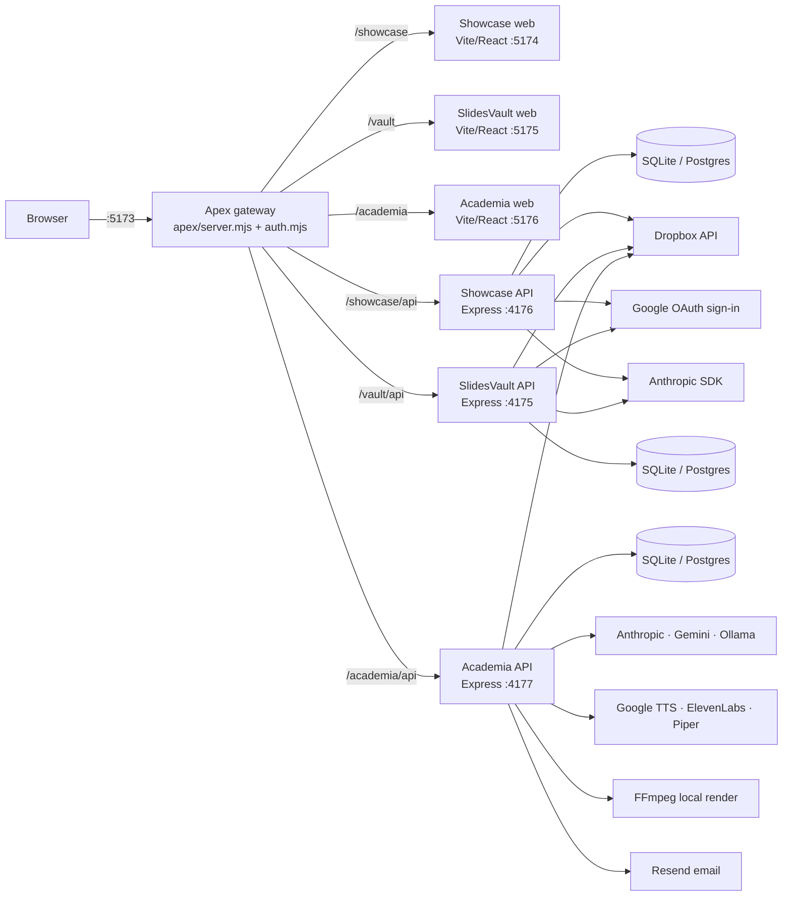

# Base44 removal — final audit

| | |
|---|---|
| Date | 2026-11-10 |
| Repository | `E:\apex`, branch `feature-classification-personas` @ `ce2366e` plus uncommitted working tree |
| Type | Audit only. No source, database, environment or git changes were made; no paid API calls. |
| Method | File-level inspection, read-only database queries, dependency and import resolution, the project's own test and build scripts, and a network recorder preloaded into every test process |

## 1. Executive summary

**The working tree is free of Base44.** No source file, dependency manifest, lockfile, environment
file, Docker/CI file, built bundle or database schema references Base44. No import resolves to a
Base44 package, and all test suites (452 tests) pass while the network recorder logged zero outbound
hosts other than `127.0.0.1`. Every workflow runs on APEX's own APIs, database, Dropbox, and
independently configured AI, voice and video providers.

**This independence exists only in uncommitted changes.** Every branch, local and remote (`main`,
`origin/main`, `feature-classification-personas` and all others), still tracks 42 Base44 files and
53 files mentioning Base44 at their tip. At HEAD, Base44 was an optional, configurable integration:
- Academia: `AI_PROVIDER=base44`, plus a Base44 voice-over provider. Stored error records show it was
  actually used and hit its credit limit.
- SlidesVault: `@base44/sdk`, with a `base44.app` client selected by `VITE_BASE44_APP_ID`.

Deploying from git today would ship that code.

**Verdict: B — BASE44 REMOVED, VALIDATION PENDING** (for the current working tree). The real AI and
voice providers, Postgres and the browser UI have not been runtime-tested. For the committed state of
any branch the verdict would be **C — Partially independent** until the removal is committed.

## 2. Repository architecture

| Component | Location | Notes |
|---|---|---|
| Gateway (dashboard, single sign-in, reverse proxy) | `apex/` (`server.mjs`, `auth.mjs`, `run.mjs`, `projects.mjs`) | Signs in by posting to each app's own login; HMAC-signed `apex_session` |
| Innovation Showcase | `inspironics-innovation-showcase/` — `apps/api`, `apps/web`, `packages/shared` | CI: `.github/workflows/ci.yml` |
| SlidesVault | `slide vault/` — `apps/api`, `apps/web`, `packages/shared` | Docker: `apps/api/Dockerfile`, `docker-compose.yml` |
| Inspironics Academia | `Inspironics Academia/` — `apps/api`, `apps/web`, `packages/shared` | AI Studio, video engine, jobs, Dropbox processing |
| Databases | `*/apps/api/data/*.db` (SQLite; Postgres via `DATABASE_URL`) | Migrations in each `apps/api/src/db/` |
| Authentication | Academia `apps/api/src/auth/`; SlidesVault `apps/api/src` (`userRepository.js`); Showcase `apps/api/src/lib/crypto.js`; gateway `apex/auth.mjs` | scrypt password hashes, server-side sessions, httpOnly cookies |
| Dropbox | Each API's `dropbox/` or `integrations/dropbox/` | OAuth with encrypted refresh tokens |
| AI Studio | Academia `apps/api/src/{ai,media,studio,usage,jobs}/`, web `components/studio/` | |
| Background work | Academia `jobs/queue.js`, sync scheduler, daily jobs; SlidesVault `SyncScheduler`; Showcase `sync/scheduler.js` | All in-process |
| Environment files | `.env` (git-ignored) and `.env.example` per API, `.env.example` per web app | |
| Legacy | `inspironics-innovation-showcase/legacy/nextjs-app` (Next.js + OpenAI prototype, not a workspace, unused) | No Base44 content. Base44 legacy folders are deleted in the working tree (§9) |

## 3. Base44 reference scan

Searches: `base44` (case-insensitive) across all text files including git-ignored ones (`.env`,
`dist/`, `data/`), excluding only `node_modules` and `.git`. Also searched: `@base44`, `base44Client`,
`createClient(`, `base44.app|com|io`, `VITE_BASE44`, `BASE44_`, `appId`, `requiresAuth`,
`functions_version`. Lockfiles, installed packages, database contents (read-only SQL) and built
bundles were checked separately.

| Location | Occurrences | Classification |
|---|---:|---|
| `Inspironics Academia/docs/ai-studio/BASE44_DEPENDENCY_AUDIT.md` | 246 | 4 — Historical documentation |
| `…/docs/ai-studio/BASE44_REMOVAL_REPORT.md` | 21 | 4 |
| `…/docs/ai-studio/MIGRATION_GUIDE.md` | 12 | 4 |
| `…/docs/ai-studio/TESTING_REPORT.md` | 7 | 4 |
| `FINAL_PRODUCTION_READINESS_REPORT.md` | 7 | 4 |
| `…/docs/BUILD_SPEC.md` | 6 | 4 |
| `…/docs/ai-studio/GENERATION_COST_OPTIMIZATION.md` | 2 | 4 |
| `…/docs/ai-studio/AI_STUDIO_ARCHITECTURE.md` | 1 | 4 |
| Any `.js/.jsx/.mjs/.ts/.json/.bat` source, config, script, `.env*`, Dockerfile, compose, CI | **0** | — |
| `package-lock.json` (all three) | **0** | — |
| Built bundles (`*/apps/web/dist`, rebuilt during this audit) | **0** | — |
| `slide vault/node_modules/@base44/` | empty directory | 3 — Unused leftover (no files, no package depends on it) |
| `academy.db` → `e_chapter.content` (3 rows), `e_playbook_version.chapters_snapshot` (1 row) | 4 | 6 — False positive: playbook text about a product called "Base44 Vanguard" |
| `academy.db` → `e_meeting.briefing_error` (3 meetings) | 3 | 4 — Stale historical data: `Base44 GenerateSpeech error (402): You have reached the limit of integ…` |
| `data/backups/academy-before-categories-20261103.db` | 4 | 6 — same playbook text (backup) |
| Git HEAD of every branch | 53 files, 42 Base44 paths | Historical/committed code — see §9 |

There are no category 1 (active dependency), category 2 (active API call) or category 5 (test fixture
or mock) occurrences in the working tree. The previous Base44 tests (`test/base44*.test.js`) are deleted.

## 4. Frontend dependency audit

| App | API client | External URLs in source | Base44 imports | Required env |
|---|---|---|---|---|
| Academia web | `src/api/client.js` → `drivers/http.js` (`fetch` to `VITE_API_BASE_URL` or `/`) or `drivers/demo` | `fonts.googleapis.com`, `api.qrserver.com` (certificate QR image), `https://your-host` (placeholder) | 0 (366 files) | `VITE_API_BASE_URL` |
| SlidesVault web | `src/api/backendClient.js` → `apiClient.js` (`fetch` to `VITE_API_BASE_URL`) or opt-in `localClient.js` demo (`VITE_DEMO_MODE`) | none | 0 (42 files) | `VITE_API_BASE_URL`, `VITE_DEMO_MODE` |
| Showcase web | `src/shared/lib/apiClient.js` (rooted `/api/...`) | `accounts.google.com` (sign-in link) | 0 (106 files) | none read via `import.meta.env` |

- `entities.js`, `functions.js` and `integrations.js` in SlidesVault now import `getClient` from
  `./backendClient` (verified). `base44Client.js` is deleted and `@base44/sdk` is removed from
  `apps/web/package.json`.
- Workflow traces:
  - Academia: 86 modules import `@/api/client`; every call goes to `/api/...` on the Academia API.
  - SlidesVault: login, catalog, Dropbox settings and AI copilot go through `backendClient` to the SlidesVault API.
- No UI action calls a Base44 function or endpoint, so nothing breaks if Base44 is unavailable.
- Not Base44, but unused: Academia web declares `@stripe/react-stripe-js`, `@stripe/stripe-js`,
  `lodash`, `moment`, `next-themes`, `react-leaflet`, `react-quill-new`, `tailwindcss-animate` and
  `three`, none of which is imported. SlidesVault web declares `moment`, which is unused.

## 5. Backend dependency audit

External hosts referenced in backend source:

| API | Hosts |
|---|---|
| Academia | `api.dropboxapi.com`, `content.dropboxapi.com`, `www.dropbox.com`, `oauth2.googleapis.com`, `www.googleapis.com`, `texttospeech.googleapis.com`, `generativelanguage.googleapis.com`, `api.elevenlabs.io`, `api.resend.com`, and Anthropic through `@anthropic-ai/sdk` |
| SlidesVault | Dropbox, `accounts.google.com`, `oauth2.googleapis.com`, and Anthropic through the SDK |
| Showcase | Dropbox, Google OAuth, and Anthropic through the SDK |
| Gateway | none (only `evil.example` in a CSRF test) |

**Runtime dependencies.** No API declares Base44:
- Academia API: `@anthropic-ai/sdk`, `@resvg/resvg-js`, `cookie-parser`, `express`, `ffmpeg-static`, `jszip`, `pdf-parse`.
- SlidesVault API and Showcase API: `@anthropic-ai/sdk`, `cookie-parser`, `express`, `jszip`.

Lazily imported optional modules: `pg` (installed), and `nodemailer` and `pdfjs-dist` (not installed;
only needed for SMTP email and the SlidesVault PDF reader).

**Workflow traces (Academia).** Routes are mounted in `apps/api/src/app.js:52-62`.

| Workflow | Trace |
|---|---|
| Authentication | `POST /api/auth/*` → `auth/` (scrypt, `sessions` table) → httpOnly `SameSite=Lax` cookie |
| Lesson / assessment generation | `POST /api/functions/{generateLessonContent,generateAssessment}` → `pipeline/*` → `ai/index.js invokeLLM` → `PROVIDERS = { anthropic, gemini, ollama }` (`ai/index.js:27`) → `e_lesson`, `e_question` |
| AI Studio content | `POST /api/studio/generate` → `studio/routes.js` → `invokeLLM` → `generation_log` |
| Voice generation | `POST /api/studio/voice` or lesson media → `media/index.js synthesize` → `TTS_PROVIDERS = { google, elevenlabs, piper }` (`media/index.js:24`) → object store `/api/media/<key>` |
| Video rendering | `POST /api/studio/projects/:id/render` → `jobs/queue.js` → `pipeline/renderVideo.js` → `media/video/{slides,renderer,ffmpeg}.js` (local FFmpeg) → object store |
| Meeting briefing | `POST /api/functions/generateMeetingVideo` / `renderMeetingVideo` → same AI, TTS and video stack |
| Dropbox sync | scheduler or `POST /api/sync/*` → `sync/pipeline.js` → `dropbox/client.js` (Dropbox HTTP API) → `e_playbook`, `e_meeting` |
| Dropbox processing | `POST /api/studio/projects/from-dropbox` → `dropbox/processing.js` → Dropbox download into memory → `pipeline/text.js` |
| Uploads / previews | `POST /api/files`, `GET /api/playbooks/:id/content`, `GET /api/media/:key`, `GET /api/outputs/...` → local object store or Dropbox stream |

The job registry (`pipeline/index.js:22-44`) has no Base44 handler, and there is no Base44 webhook route.

## 6. AI Studio independence

| Area | Evidence | Status |
|---|---|---|
| Text providers | `ai/providers/{anthropic,gemini,ollama}.js`. Anthropic uses the official SDK with streaming, adaptive thinking and server-side refusal fallback. Gemini uses REST with the key in the `x-goog-api-key` header. Ollama is HTTP to `OLLAMA_BASE_URL` | Independent |
| Keys | `ANTHROPIC_API_KEY`, `GEMINI_API_KEY` (+`GEMINI_MODEL`), `OLLAMA_BASE_URL`/`OLLAMA_MODEL`; read on the server only; 0 key strings in bundles | Independent |
| Fallback | `AI_FALLBACK_PROVIDER`; switches only on availability errors (`ai/index.js:70,133-136`) | Tested (mocked) |
| Voice | `media/providers/{google-tts,elevenlabs,piper}.js`; `MEDIA_PROVIDER` picks the default | Tested (mocked) |
| Video | FFmpeg via `ffmpeg-static`, SVG slides via `@resvg/resvg-js`. A real MP4 on disk decodes with 0 errors (checked in the preceding readiness review) | Independent, runtime-verified |
| Caching | AI content cache, audio cache keyed by inputs, scene cache | Tested |
| Background / retry | `jobs/queue.js` (dedupe, cancel, retry, restart recovery); the Anthropic SDK retries 408/409/429/5xx; Dropbox retries honour Retry-After | Tested |
| Usage and cost | `usage/{log,limits,pricing}.js`; `generation_log` table | Tested |
| Routing through Base44 | None: no provider, route, job or env name | **Verified** |

No paid calls were made. Provider behaviour is verified with mocked HTTP in `aiRouter.test.js`,
`tts.test.js` and `studio.test.js`, not with live keys. Locally, `ANTHROPIC_API_KEY` and `GEMINI_API_KEY`
are empty and `MEDIA_PROVIDER=none`.

## 7. Database and authentication independence

**Tables (live databases, read-only):**
- **Academia:** `e_*` entity tables (25), `email_outbox`, `generation_log`, `jobs`, `locks`,
  `login_history`, `password_resets`, `schema_migrations`, `sessions`, `settings`, `sync_log`, `users`.
- **SlidesVault:** `advisory_lock`, `app_user`, `audit_log`, `login_history`, `oauth_code_exchange`,
  `oauth_state`, `presentation_analytics`, `presentation_view`, `schema_migrations`,
  `storage_connection`, `stored_file`, `sync_log`, `user_session`.
- **Showcase:** `app_locks`, `auth_codes`, `dropbox_connection`, `login_history`, `oauth_states`,
  `plate_events`, `schema_migrations`, `sessions`, `settings`, `stored_file`, `sync_log`, `users`.

**No Base44 schema objects.** No table or column name contains Base44, and no migration file in any
app mentions it.

**All media and file references are local or Dropbox.** Every `*_url` value in Academia is either
`/api/media/<key>` or `dropbox:id:…`, and every SlidesVault `thumbnail_url` is `/api/assets/…`. No
record points at a Base44-hosted file.

**Base44-shaped, but not Base44.** The Academia entity API (`/api/entities`, `/api/functions`, fields
`created_date`/`updated_date`/`created_by_id`) and the RLS rule grammar (`packages/shared/src/rls.js`)
keep the shape of the original Base44 app. They are APEX's own Express and SQL code, not a dependency.

**Authentication** is fully local in every app:
- scrypt password hashes with `timingSafeEqual`.
- Server-side session tables, `randomBytes` tokens, and httpOnly cookies.
- Google OAuth sign-in (Showcase, SlidesVault).
- The gateway keeps no user store; it forwards credentials to each app's login.

**Stale data:** 3 Academia meetings keep a `briefing_error` from the Base44 voice provider. This is
display-only and is replaced when the briefing is regenerated. Nothing was modified.

## 8. Environment and deployment audit

| Item | Finding |
|---|---|
| `.env` files (3, git-ignored; 72 / 54 / 20 variables) | 0 Base44 variable names (values not printed) |
| `.env.example` files (7, including legacy) | 0 Base44 references |
| SlidesVault `Dockerfile` | `node:24-alpine`, `npm ci --omit=dev`, `CMD node src/index.js`; no Base44 |
| SlidesVault `docker-compose.yml` | Dropbox, session and AI variables; no Base44 |
| Showcase CI (`.github/workflows/ci.yml`) | `npm ci`, tests, architecture lint, typecheck, route check, build, bundle check; no Base44 |
| Start scripts | `start.bat`, `stop.bat`, `apex/run.mjs`, `projects.mjs`, `slide vault/start.bat`. The SlidesVault script now reads `VITE_API_BASE_URL` instead of `VITE_BASE44_APP_ID` (uncommitted change) |
| Variables the gateway passes | `APEX_*`, `API_BASE_URL`, `APP_BASE_URL`, `DROPBOX_REDIRECT_URI`, `GOOGLE_REDIRECT_URI`, `PUBLIC_API_URL`, `VITE_API_BASE_URL`, `VITE_BACKEND`; no Base44 |

Variable status:
- **Required and active:** Dropbox keys and secrets, `TOKEN_ENCRYPTION_KEY`, and `VITE_API_BASE_URL`.
- **Required for AI and voice (missing locally):** the provider keys listed in §6.
- **Unused Base44 variables:** none.
- **Historical configuration:** none in the working tree. HEAD still has `BASE44_APP_ID`,
  `BASE44_SERVER_URL`, `BASE44_EMAIL` / `BASE44_PASSWORD` and `VITE_BASE44_APP_ID` (§9).

## 9. Git and legacy audit

| Check | Result |
|---|---|
| Base44 paths tracked at the tip of each branch | `main`, `origin/main`, `feature-classification-personas` (+origin), `feature-meeting-module` (+origin), `origin/vault-dropbox-api`, `origin`: **42 each** |
| Files mentioning Base44 at HEAD | 53 |
| Working tree | All 42 Base44 paths are **staged as deleted**: Academia `legacy/base44/**` (24 files), `apps/api/src/ai/base44.js`, `ai/claude.js`, `media/providers/base44.js`, `test/base44*.test.js`; SlidesVault `legacy/base44/**` (13), `apps/web/src/api/base44Client.js` |
| Uncommitted changes | 69 modified, 43 staged deletions, 67 untracked (incl. the new `backendClient.js` and AI Studio modules). The migration in the working tree is complete; no file references a removed module (all builds and tests pass) |
| What HEAD did with Base44 | **Academia:** `config.js` offered `AI_PROVIDER=base44` (Base44 InvokeLLM, "billed to the Base44 plan's integration credits"), and `media/providers/base44.js` called Base44 GenerateSpeech. The stored 402 errors show it was used. **SlidesVault web:** `base44Client.js` used `VITE_BASE44_APP_ID` / `VITE_BASE44_SERVER_URL` (default `https://base44.app`) and `@base44/sdk` |
| History | 4 commits touch Base44 paths (`4c8d2f2`, `16f60bb`, `97760b6`, `d900d05`); `@base44/sdk` was added in `16f60bb`. History was not modified |
| Stray file | Repository root `ync handling` (untracked, not Base44) |

## 10. Test and build results

All commands are the projects' own scripts, run with `TMP` on E: (C: has under 30 MB free) and a
read-only network recorder (`node --import`, observing `fetch`, `http` and DNS).

| Check | Result |
|---|---|
| Academia API `npm test` | **187 / 187 pass** |
| SlidesVault API `npm test` | **203 / 203 pass** |
| Showcase API `npm test` | **49 / 49 pass** |
| Showcase shared `npm test` | **3 / 3 pass** |
| Gateway `node --test auth.test.mjs` | **10 / 10 pass** |
| Academia web `npm run build` | **Built** |
| SlidesVault web `npm run build` | **Built** |
| Showcase web `npm run build` (architecture lint, typecheck, env check, 75 web tests, route check, bundle check) | **All pass, built** |
| Import validation (custom read-only resolver over 751 source files) | 0 Base44 imports. Every other bare import is a declared dependency, a Node built-in, a path alias, or an optional lazy import (`pg`, `nodemailer`, `pdfjs-dist`) |
| Network hosts contacted during all test runs | `127.0.0.1` only; **0 Base44 hosts** |
| Live servers (all 7 running) | 0 established outbound connections from 25 Node processes; DNS cache has 0 Base44 entries |
| Static analysis | Showcase: yes (above). Academia and SlidesVault have no lint scripts, so none was run |
| Dependency tree | 0 Base44 packages in all lockfiles; the only `@base44` directory on disk is empty |

**Total: 452 tests, 0 failures.** Tests use mocked Dropbox and mocked AI/TTS HTTP, so the recorder
proves no real network use rather than exercising live providers.

## 11. Base44 shutdown simulation

**Method.** No code path in the working tree can reach Base44:
- no host, SDK, env name or route;
- the network recorder logged none across 452 tests;
- the live servers have no such connections.

A Base44 shutdown is therefore equivalent to the current state.

| Capability | Classification | Evidence |
|---|---|---|
| Start successfully | **Independent and verified** | 7 processes running and healthy (`/api/health` 200 on 4175/4176/4177) |
| Authenticate users | **Independent and verified** | Local scrypt and sessions; auth tests in all suites; gateway tests 10/10 |
| Load dashboards | **Independent and verified** | Builds; gateway serves sign-in; web apps return 200 |
| Read and write application data | **Independent and verified** | SQLite through each app's repository layer; entity tests |
| Process Dropbox documents | **Independent and verified (mocked Dropbox)**; live read-only browse of the real Dropbox in the previous review | `dropboxStorage.test.js`, sync tests |
| Generate AI content | **Independent but not runtime-tested** | No keys configured; mocked provider tests pass |
| Generate voice-over | **Independent but not runtime-tested** | `MEDIA_PROVIDER=none` locally; mocked Google/ElevenLabs tests pass |
| Render videos | **Independent and verified** | Local FFmpeg; real MP4 rendered and decoded; render tests |
| Manage lessons and meetings | **Independent and verified** | Content pipeline and meeting tests |
| Background jobs | **Independent and verified** | Queue tests (cancel, retry, restart); schedulers in-process |
| User permissions | **Independent and verified** | RLS evaluator `packages/shared/src/rls.js` (APEX code); admin-only route tests |
| Postgres deployment | **Not enough evidence** | No Postgres available; statically compatible |
| Deploying from git (any branch) | **Partially dependent** | Committed code still contains the optional Base44 AI, voice and SlidesVault client |

## 12. Remaining dependencies

| Type | Item | Impact if Base44 shuts down |
|---|---|---|
| Uncommitted removal | All branches still carry the Base44 code at HEAD | A deployment from git could be configured to use Base44 and would fail for those features |
| Stale data | 3 `e_meeting.briefing_error` values mention Base44 | Cosmetic; old error text is shown until regenerated |
| Empty leftover | `slide vault/node_modules/@base44/` | None |
| Historical docs | 8 Markdown files | None |
| Not Base44, but external | `api.qrserver.com` for certificate QR codes (Academia web) | Unrelated to Base44; certificate QR images depend on that third-party service |

There are **no active runtime Base44 dependencies in the working tree.**

## 13. Risks and recommendations

1. **Commit the removal.** Until it is committed and merged, the repository's source of truth still
   contains Base44, and a fresh clone or deploy would not have the replacement code.
2. **Validate live providers** with one approved, low-cost smoke test each: Anthropic or Gemini text,
   Google or ElevenLabs voice.
3. **Run the suites once against Postgres** before a Postgres deployment.
4. **Walk through the UI in a browser:** AI Studio, the SlidesVault login and catalog, Academia lessons.
5. **Optional clean-ups (low risk, need approval):**
   - Clear the 3 stale `briefing_error` values, or regenerate those briefings.
   - Remove the empty `node_modules/@base44` folder with a clean `npm ci`.
   - Drop the unused template-era web dependencies listed in §4.
   - Delete or ignore the stray `ync handling` file.
6. **Optionally replace `api.qrserver.com`** with a locally generated QR code. It isn't Base44, but it
   is an external call from certificate pages.
7. **Free disk space on C:.** Under 30 MB is free, and temp-dependent work (renders, Piper, npm) can
   fail on this machine.

## 14. Final verdict

### **B. BASE44 REMOVED, VALIDATION PENDING**

**Supporting evidence (verified):**
- 0 Base44 references in any source, configuration, environment, Docker, CI, lockfile, installed
  package or built bundle (§3, §8).
- 0 Base44 imports across 751 source files (§10).
- 0 Base44 network contacts across 452 passing tests and the live servers (§10).
- No Base44 tables, columns or migrations, and no records pointing at Base44-hosted files (§7).
- Every workflow traced end to end to APEX's own APIs, database, Dropbox and independent providers (§5).

**Why not A:**
- Live AI text and voice providers are not runtime-tested (no keys; paid calls not authorised).
- Postgres is untested.
- The browser UI is not walked through.
- The removal is uncommitted: every branch in git still contains the Base44 integration, so for the
  committed state the verdict would be **C — Partially independent**.

**Assumptions (not verified):**
- The providers' real APIs behave as the mocked tests expect.
- Deployment will use the working-tree code, once it is committed.

### Exact remaining actions for complete Base44 independence

1. Commit the working-tree removal on `feature-classification-personas`, excluding `.env`, databases
   and the stray `ync handling` file.
2. Merge it into `main`, so no deployable branch carries Base44.
3. Configure one AI provider and one voice provider, then run an approved live smoke test of each.
4. Run the API suites against a Postgres test database.
5. Do a browser walkthrough of AI Studio (content, voice, video, storage), Academia lessons and
   meetings, and the SlidesVault login and catalog.
6. Optional: clear the 3 stale Base44 error messages, reinstall SlidesVault dependencies so the empty
   `@base44` folder disappears, and prune the unused web dependencies.
